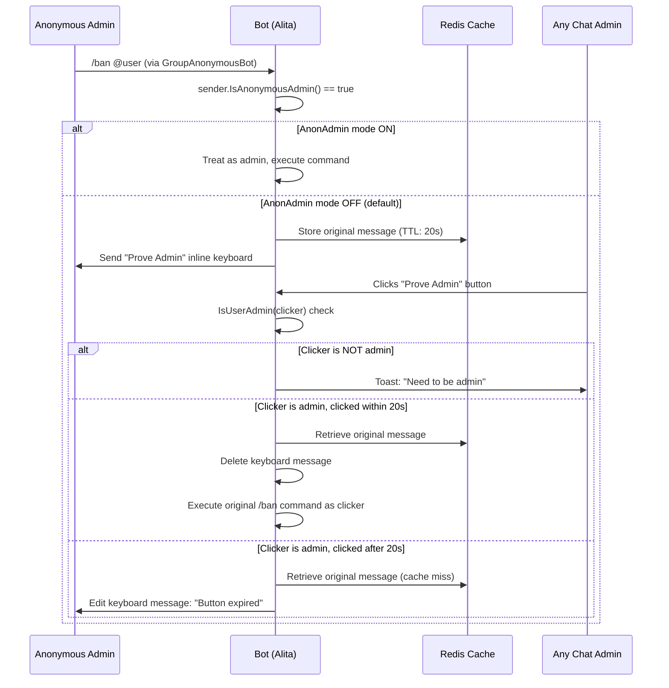

# Anonymous Admin Verification

When a group admin enables "Send as Group" (anonymous admin mode), Telegram sends their messages as `GroupAnonymousBot` (ID `1087968824`). The bot cannot identify which admin sent the command. Alita Robot provides two modes to handle this: automatic trust (AnonAdmin ON) or keyboard verification (AnonAdmin OFF, the default).

## AnonAdmin Modes

### AnonAdmin Mode ON (`/anonadmin on`)

When enabled via admin settings, the bot treats all anonymous admin messages as legitimate admin commands. The command executes immediately without verification.

:::caution[Security trade-off]
AnonAdmin ON is faster but any admin can execute commands without individual accountability. There is no audit trail of which specific admin performed an action.
:::

### AnonAdmin Mode OFF (default)

When AnonAdmin mode is off (the default), the bot uses keyboard verification:

1. The bot stores the original message in Redis with a 20-second TTL.
2. An inline keyboard with a "Prove Admin" button is sent to the chat.
3. Any chat admin can click the button to verify and execute the command.
4. After 20 seconds the cached message is evicted. Nothing runs on a timer: an admin who clicks after that sees the keyboard message edited to "Button expired".

## Verification Flow

The following sequence diagram shows the complete verification process for both modes:

## Technical Details

- **Cache key format:** `alita:anonAdmin:{chatId}:{msgId}` with 20-second TTL
- **Callback data encoding:** Versioned codec format `anon_admin|v1|c={chatId}&m={msgId}` only; unversioned or malformed payloads are rejected with "Invalid request." (`alita:anonAdmin:{chatId}:{msgId}` is the Redis cache key above, not a callback format)
- **Command replay:** After verification, the bot restores the original cached message, clears `SenderChat`, replaces the callback update with the original message update, and sets the effective actor to the admin who tapped. `helpers.ReplayCommand` runs the same pipeline registered by `WrapCommand`, under the typed name or alias, preserving arguments, media and the replied-to message. Checks run with the confirming admin's rights; proof does not grant missing rights or ownership.
- **Non-admin click handling:** Shows a toast notification ("Need to be admin") without error; does not consume the keyboard

## Supported Commands

Every command registered with `helpers.WrapCommand` automatically has replay under its name and every alias. No separate replay registration is needed. Commands still using legacy registration are being migrated; the dispatcher-wide command contract test names their remaining failures.

## Troubleshooting

:::tip[Common issues]
- **"Button expired"** -- An admin clicked the button after the 20-second cache entry expired. The admin must re-send the command.
- **"Need to be admin"** -- A non-admin user clicked the "Prove Admin" button. Only actual chat admins can verify.
- **Commands not executing in anonymous mode** -- Check the command's descriptor and the confirming admin's required rights. Legacy command registrations still need migration to `helpers.WrapCommand`.
:::

## Related Pages

- [Handler Group Precedence](/architecture/handler-groups) -- How message watchers interact with command processing
- [Request Flow](/architecture/request-flow) -- Full update processing pipeline
